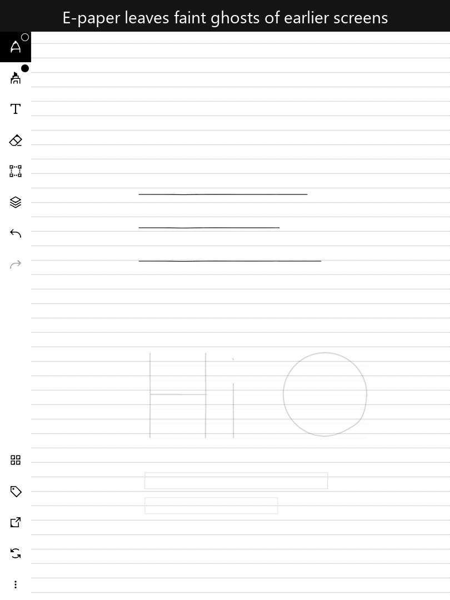

# rmpp-refresh

*One tap clears e-paper ghosting: in the notebook toolbar (above the three dots) and in the library menu (above Trash).*

A **Refresh screen** button for the reMarkable Paper Pro: one tap redraws the whole e-paper screen (a full refresh
that clears ghosting), in a notebook or in the library, and once after the on-screen keyboard opens. Runs without
xovi and keeps working after a reboot.

Tested on reMarkable Paper Pro, OS 3.29.1.

> Part of the **rmpp add-ons**, built on [rmpp-packages](https://github.com/lorancecall/rmpp-packages): it is
> installed by rmpp setup, loaded into xochitl at every boot by rmpp-preload (no xovi), and kept up to date with
> Vellum. How that differs from xovi: [how it works](https://github.com/lorancecall/rmpp-packages/blob/main/docs/how-it-works.md).

## Install

Start at **[rmpp-packages](https://github.com/lorancecall/rmpp-packages#install)**: it explains developer mode and
has **rmpp setup**, the installer for all rmpp add-ons.

- In rmpp setup, tick **Screen refresh button** (rmpp-refresh).
- After a reMarkable OS update: **Restore** in rmpp setup.
- Other ways (Vellum on the command line, building and installing it yourself) and removal:
  [docs/install.md](docs/install.md).

## Use

- **Notebook:** tap **Refresh screen** in the toolbar, right above the three dots (⋯). It closes the toolbar menu,
  then asks xochitl's own ghost buster for a full refresh (`DocumentView.ghostBuster.userRequestedClear()`, the same
  refresh xochitl does by itself after some screens).
- **Library:** tap **Refresh screen** in the left sidebar (☰), right above Trash (the library's ghost buster,
  `MainView.ghostBuster`).
- **Keyboard:** nothing to do: the screen refreshes once after the on-screen keyboard opens (opening it leaves
  ghosting in the notebook; closing it already makes xochitl redraw the page).

## How it works

`librmpp-refresh.so` is loaded into xochitl by `rmpp-preload` (`/usr/lib/rmpp/preload.d/50-rmpp-refresh.so`). It
adds a `ToolbarTool` (QML, no moc) to the toolbar's layout (`#toolbarLayout`) just before xochitl's
`secondaryToolLoader_settingsMenu`; tapping it closes the toolbar menu and,
400 ms later, calls the ghost buster. In the library it adds an `ark.controls.SidebarItem` to the sidebar's layout just
before `#filterTrashed`: the layout places it right above Trash and keeps other rows (such as other add-ons' entries)
from overlapping it. It also watches `QInputMethod::visibleChanged` and calls the ghost buster
700 ms after the keyboard appears (after its slide animation), only while a document is open.

## Build

Building and the development install: [docs/install.md](docs/install.md#build-and-install-by-hand).

## License

GPL-3.0-only. See [LICENSE](LICENSE).
